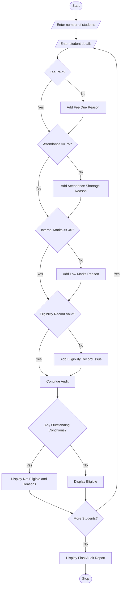

#  Integrated University Fee and Eligibility Audit

## 1. Problem Statement

To develop a Python program that combines student fee payments, attendance percentage, internal marks, and examination eligibility records. The program identifies students who have outstanding conditions and generates a reason-wise report showing whether each student is eligible for examinations.

## 2. Algorithm

1. Start the program.
2. Enter the number of students.
3. Read each student's name, fee status, attendance percentage, internal marks, and eligibility record.
4. Check the fee payment status.
5. Check whether attendance is at least 75%.
6. Check whether internal marks are at least 40.
7. Check the examination eligibility record.
8. Identify students with outstanding conditions.
9. Display the reasons for ineligibility.
10. Display the final eligibility report.
11. Stop the program.

## 3. Flowchart (Mermaid)

## 5. Sample Input

```
Enter number of students: 3

Student 1
Enter student name: Ravi
Fee paid (yes/no): yes
Enter attendance: 85
Enter internal marks: 75
Eligibility record valid (yes/no): yes

Student 2
Enter student name: Priya
Fee paid (yes/no): no
Enter attendance: 65
Enter internal marks: 30
Eligibility record valid (yes/no): yes

Student 3
Enter student name: Kumar
Fee paid (yes/no): yes
Enter attendance: 90
Enter internal marks: 80
Eligibility record valid (yes/no): no
```

## 6. Sample Output

```
Student Name: Ravi
Status: Eligible for Examination

Student Name: Priya
Status: Not Eligible
Outstanding Conditions:
- Fee Not Paid
- Low Attendance
- Low Internal Marks

Student Name: Kumar
Status: Not Eligible
Outstanding Conditions:
- Eligibility Record Missing

University Fee and Eligibility Audit Completed
```


The Python program successfully checks student fee payments, attendance, internal marks, and eligibility records. It identifies outstanding conditions and generates a reason-wise examination eligibility report.
