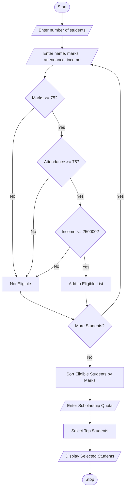

# 70. Multi-Stage Scholarship Shortlisting

## 1. Problem Statement

To develop a Python program for scholarship shortlisting by checking students' academic marks, attendance percentage, and family income. The program selects eligible students based on ranking rules and a fixed scholarship quota.

## 2. Algorithm

1. Start the program.
2. Read the number of students.
3. Read each student's name, marks, attendance, and family income.
4. Check the eligibility conditions:
   - Marks must be at least 75%.
   - Attendance must be at least 75%.
   - Family income must not exceed ₹2,50,000.
5. Store eligible students in a list.
6. Sort eligible students based on marks in descending order.
7. Read the scholarship quota.
8. Select students according to the quota.
9. Display selected students and rejected students.
10. Stop the program.

## 3. Flowchart (Mermaid)

##4. Python Source Code
```
students = []eligible = []n = int(input("Enter number of students: "))for i in range(n):    print("\nStudent", i + 1)    name = input("Enter name: ")    marks = float(input("Enter marks: "))    attendance = float(input("Enter attendance: "))    income = float(input("Enter family income: "))    students.append(name)    if marks >= 75 and attendance >= 75 and income <= 250000:        eligible.append((name, marks))    else:        print(name, "is Not Eligible")eligible.sort(key=lambda x: x[1], reverse=True)quota = int(input("\nEnter scholarship quota: "))selected = eligible[:quota]print("\nSelected Scholarship Students:")if selected:    for student in selected:        print(student[0], "-", student[1], "Marks")else:    print("No students selected")print("\nTotal Eligible Students:", len(eligible))print("Total Selected Students:", len(selected))
```

## 5. Sample Input

```
Enter number of students: 4

Student 1
Enter name: Ravi
Enter marks: 85
Enter attendance: 90
Enter family income: 200000

Student 2
Enter name: Priya
Enter marks: 92
Enter attendance: 95
Enter family income: 180000

Student 3
Enter name: Kumar
Enter marks: 65
Enter attendance: 80
Enter family income: 150000

Student 4
Enter name: Sita
Enter marks: 80
Enter attendance: 85
Enter family income: 300000

Enter scholarship quota: 2
```

## 6. Sample Output

```
Kumar is Not Eligible
Sita is Not Eligible

Selected Scholarship Students:

Priya - 92.0 Marks
Ravi - 85.0 Marks

Total Eligible Students: 2
Total Selected Students: 2
```


