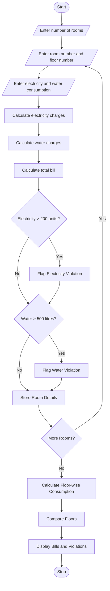

## 1. Problem Statement

To develop a Python program to monitor room-wise electricity and water consumption in a hostel. The program calculates electricity and water charges, identifies rooms exceeding consumption limits, and compares resource utilization across different floors.

## 2. Algorithm

1. Start the program.
2. Enter the number of hostel rooms.
3. Read the room number and floor number.
4. Enter electricity and water consumption.
5. Calculate electricity charges at ₹8 per unit.
6. Calculate water charges at ₹5 per unit.
7. Calculate the total bill for each room.
8. Check electricity consumption against 200 units.
9. Check water consumption against 500 litres.
10. Display threshold violations.
11. Calculate total consumption floor-wise.
12. Compare resource utilization across floors.
13. Display the final report.
14. Stop the program.

## 3. Flowchart (Mermaid)

## 5. Sample Input

```
Enter number of rooms: 3

Room 1
Enter room number: 101
Enter floor number: 1
Electricity units: 150
Water consumption in litres: 300

Room 2
Enter room number: 102
Enter floor number: 1
Electricity units: 250
Water consumption in litres: 600

Room 3
Enter room number: 201
Enter floor number: 2
Electricity units: 180
Water consumption in litres: 400
```

## 6. Sample Output

```
Room 1
Total Bill: Rs. 2700.0

Room 2
Total Bill: Rs. 5000.0
Electricity Threshold Violated
Water Threshold Violated

Room 3
Total Bill: Rs. 3440.0

Floor-wise Resource Utilization

Floor: 1
Electricity: 400.0 units
Water: 900.0 litres

Floor: 2
Electricity: 180.0 units
Water: 400.0 litres

Highest Electricity Usage Floor: 1

Monitoring Completed
```
