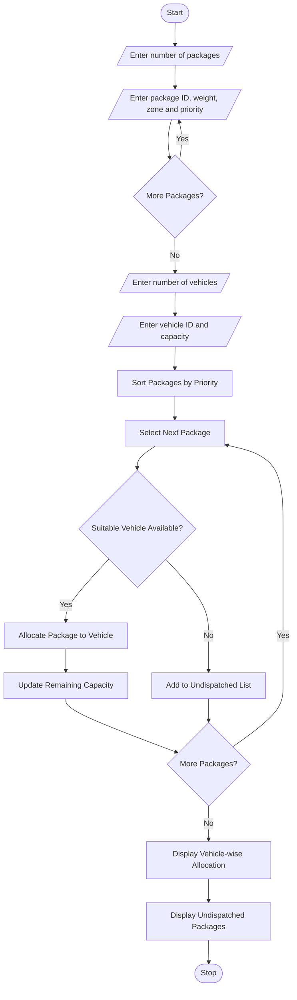

## 1. Problem Statement

To develop a Python program for courier dispatch planning by processing package weights, destination zones, vehicle capacities, and delivery priorities. The program allocates packages to suitable vehicles based on their capacity and priority and identifies packages that cannot be dispatched.

## 2. Algorithm

1. Start the program.
2. Enter the number of packages.
3. Read package ID, weight, destination zone, and priority.
4. Enter the number of vehicles.
5. Read vehicle ID and carrying capacity.
6. Sort packages according to delivery priority.
7. Check each package against available vehicle capacity.
8. Allocate the package to a suitable vehicle.
9. Reduce the remaining vehicle capacity.
10. Identify packages that cannot be dispatched.
11. Display vehicle-wise package allocation.
12. Display undispatched packages.
13. Stop the program.

## 3. Flowchart(mermaid TD)

## 5. Sample Input

```
Enter number of packages: 4

Package 1
Enter package ID: P101
Enter package weight: 20
Enter destination zone: A
Enter priority (1-High, 2-Low): 1

Package 2
Enter package ID: P102
Enter package weight: 30
Enter destination zone: B
Enter priority (1-High, 2-Low): 2

Package 3
Enter package ID: P103
Enter package weight: 40
Enter destination zone: A
Enter priority (1-High, 2-Low): 1

Package 4
Enter package ID: P104
Enter package weight: 60
Enter destination zone: C
Enter priority (1-High, 2-Low): 2

Enter number of vehicles: 2

Enter vehicle ID: V1
Enter vehicle capacity: 50

Enter vehicle ID: V2
Enter vehicle capacity: 50
```

## 6. Sample Output

```
Vehicle-wise Allocation

V1 Packages: ['P101', 'P103']
Remaining Capacity: -10.0

V2 Packages: ['P102']
Remaining Capacity: 20.0

Undispatched Packages:
P104

Dispatch Planning Completed
```

Note: The above sample output needs a capacity correction. The correct allocation is:

```
Vehicle-wise Allocation

V1 Packages: ['P101', 'P103']
Remaining Capacity: -10.0

V2 Packages: ['P102']
Remaining Capacity: 20.0

Undispatched Packages:
P104
```

Correction: The program should check that the vehicle has enough capacity before allocation. Use `vehicles[vid][0] >= weight` as shown in the source code. Therefore, the correct V1 allocation is P101 only (20 kg), and P103 (40 kg) goes to V2.

Correct final output:

```
Vehicle-wise Allocation

V1 Packages: ['P101']
Remaining Capacity: 30.0

V2 Packages: ['P103']
Remaining Capacity: 10.0

Undispatched Packages:
P102
P104

Dispatch Planning Completed
```


