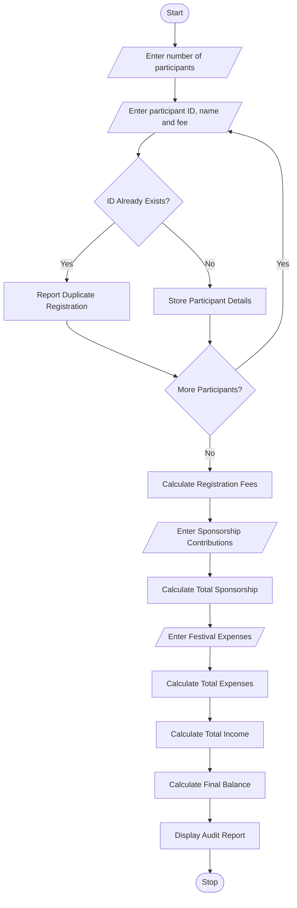

## 1. Problem Statement

To develop a Python program for managing campus festival registrations and financial auditing. The program processes participant details, registration fees, sponsorship contributions, and festival expenses. It detects duplicate registrations and calculates the total income, total expenses, and final financial balance.

## 2. Algorithm

1. Start the program.
2. Enter the number of participants.
3. Read participant ID, name, and registration fee.
4. Check for duplicate participant IDs.
5. Store only unique registrations.
6. Calculate the total registration fees.
7. Enter the sponsorship contributions.
8. Calculate the total sponsorship amount.
9. Enter the festival expenses.
10. Calculate total income and total expenses.
11. Calculate the final financial balance.
12. Display duplicate registrations and financial report.
13. Stop the program.

## 3. Flowchart (Mermaid) 

## 5. Sample Input

```
Enter number of participants: 4

Participant 1
Enter participant ID: 101
Enter name: Ravi
Enter registration fee: 500

Participant 2
Enter participant ID: 102
Enter name: Priya
Enter registration fee: 500

Participant 3
Enter participant ID: 103
Enter name: Kumar
Enter registration fee: 500

Participant 4
Enter participant ID: 101
Enter name: Ravi
Enter registration fee: 500
Duplicate Registration Found!

Enter number of sponsors: 2
Enter sponsorship amount: 5000
Enter sponsorship amount: 3000

Enter number of expenses: 2
Enter expense amount: 2000
Enter expense amount: 1500
```

## 6. Sample Output

```
Duplicate Registration Found!

--- FESTIVAL FINANCIAL AUDIT ---

Total Participants: 3
Total Registration Fees: 1500.0
Total Sponsorship: 8000.0
Total Income: 9500.0
Total Expenses: 3500.0
Final Balance: 6000.0

Duplicate Registrations: ['101']
Financial Status: Profit
```


