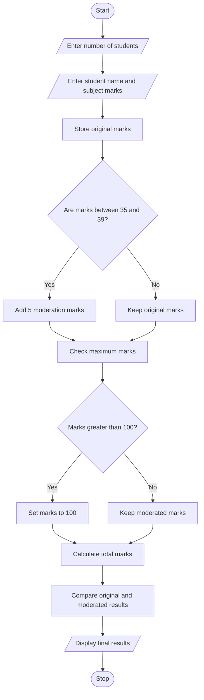

## 1. Problem Statement

Develop a Python program to process students' marks across multiple subjects and apply moderation rules. The program should check the original marks, add moderation marks when required, ensure that marks do not exceed the maximum marks, and compare original and moderated results. Finally, display the original marks, moderated marks, and final result of each student.

## 2. Algorithm

1. Start the program.
2. Read the number of students and subjects.
3. Enter student names and their subject marks.
4. Store the original marks.
5. Check whether each subject's marks are below the passing marks.
6. If marks are between 35 and 39, add 5 moderation marks.
7. Ensure that moderated marks do not exceed 100.
8. Calculate original and moderated total marks.
9. Display original marks and moderated marks.
10. Display the final result.
11. Stop the program.

## 3. Flowchart (Mermaid Code)





## 5. Sample Input

```
UNIVERSITY EXAMINATION RESULT MODERATION
Enter number of students: 2
Enter number of subjects: 3

Enter student name: Ravi
Enter subject marks: 45
Enter subject marks: 37
Enter subject marks: 60

Enter student name: Priya
Enter subject marks: 30
Enter subject marks: 55
Enter subject marks: 38
```

## 6. Sample Output

```
UNIVERSITY EXAMINATION RESULT MODERATION

Student Name: Ravi
Original Marks: [45, 37, 60]
Moderated Marks: [45, 42, 60]
Original Total: 142
Moderated Total: 147
Original Result: FAIL
Moderated Result: PASS

Student Name: Priya
Original Marks: [30, 55, 38]
Moderated Marks: [30, 55, 43]
Original Total: 123
Moderated Total: 128
Original Result: FAIL
Moderated Result: FAIL
```
