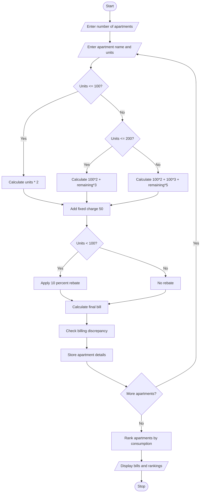

## 1. Problem Statement

Develop a Python program to calculate electricity bills for multiple apartments using progressive tariff rates, fixed charges, and rebates. The program should calculate apartment-wise electricity charges based on consumption units, identify billing discrepancies, and rank apartments according to their electricity consumption. Finally, display the total bill and consumption ranking of all apartments.

## 2. Algorithm

1. Start the program.
2. Enter the number of apartments.
3. Enter each apartment name and electricity consumption units.
4. Calculate electricity charges using progressive tariffs:
   - First 100 units: ₹2 per unit.
   - Next 100 units: ₹3 per unit.
   - Above 200 units: ₹5 per unit.
5. Add a fixed charge of ₹50.
6. Apply a 10% rebate if consumption is below 100 units.
7. Calculate the final electricity bill.
8. Check for billing discrepancies.
9. Store apartment details and bills.
10. Rank apartments based on electricity consumption.
11. Display apartment-wise bills and rankings.
12. Stop the program.

## 3. Flowchart (Mermaid Code)





      

## 5. Sample Input

```
SMART ELECTRICITY BILLING SYSTEM
Enter number of apartments: 3

Apartment 1
Enter apartment name: A101
Enter electricity units: 80
Enter previous calculated bill: 194

Apartment 2
Enter apartment name: A102
Enter electricity units: 150
Enter previous calculated bill: 400

Apartment 3
Enter apartment name: A103
Enter electricity units: 250
Enter previous calculated bill: 1050
```

## 6. Sample Output

```
--- ELECTRICITY BILL REPORT ---

Apartment: A101
Units Consumed: 80
Final Bill: Rs. 194.0
Billing Status: No Discrepancy

Apartment: A102
Units Consumed: 150
Final Bill: Rs. 400.0
Billing Status: No Discrepancy

Apartment: A103
Units Consumed: 250
Final Bill: Rs. 1050.0
Billing Status: No Discrepancy

--- CONSUMPTION RANKING ---

1 A103 - 250 units
2 A102 - 150 units
3 A101 - 80 units
```


