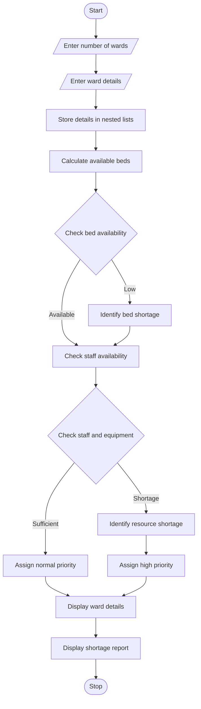

Problem Statement:

Develop a Python program to analyse hospital resources across multiple wards using nested lists. The program should process bed occupancy, available staff, and medical equipment details. Identify resource shortages, check ward capacity, and prioritize wards based on resource availability and patient requirements.

## 1. Algorithm

1. Start the program.
2. Read the number of hospital wards.
3. Enter ward names, total beds, occupied beds, available staff, and required equipment.
4. Store the details using nested lists.
5. Calculate available beds in each ward.
6. Check bed, staff, and equipment shortages.
7. Assign priority based on resource shortages.
8. Display ward-wise resource details.
9. Display shortage reports and priority levels.
10. Stop the program.

## 2. Flowchart (Mermaid)




## 4. Sample Input

```
Enter number of wards: 2

Enter details for Ward 1
Ward name: General
Total beds: 20
Occupied beds: 19
Available staff: 2
Available equipment: 3
Required equipment: 5

Enter details for Ward 2
Ward name: ICU
Total beds: 10
Occupied beds: 5
Available staff: 6
Available equipment: 8
Required equipment: 5
```

## 5. Sample Output

```
--- Hospital Resource Report ---

Ward: General
Available Beds: 1
Available Staff: 2
Shortages: Bed shortage, Staff shortage,
Equipment shortage
Priority: HIGH

Ward: ICU
Available Beds: 5
Available Staff: 6
Resource Status: Sufficient
Priority: NORMAL

Hospital Resource Analysis Completed
```
