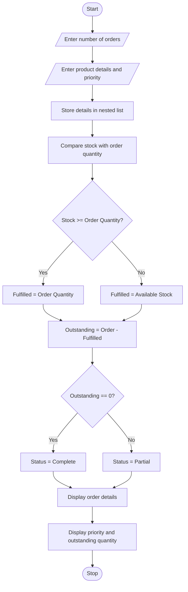

Problem Statement:

Develop a Python program to process product demand, available stock levels, order quantities, and priority categories in a warehouse. Determine whether each order can be fulfilled completely or partially, calculate outstanding quantities, and display orders according to their priority levels.

## 1. Algorithm

1. Start the program.
2. Read the number of orders.
3. Enter product name, available stock, order quantity, and priority category.
4. Store order details using a nested list.
5. Compare available stock with order quantity.
6. Calculate fulfilled quantity.
7. Calculate outstanding quantity.
8. Determine fulfilment status (Complete or Partial).
9. Display order details according to priority.
10. Stop the program.

## 2. Flowchart (Mermaid)




    

## 4. Sample Input

```
Enter number of orders: 3

Enter Order 1
Product name: Laptop
Available stock: 20
Order quantity: 15
Priority (High/Medium/Low): High

Enter Order 2
Product name: Mouse
Available stock: 10
Order quantity: 25
Priority (High/Medium/Low): Medium

Enter Order 3
Product name: Keyboard
Available stock: 30
Order quantity: 20
Priority (High/Medium/Low): Low
```

## 5. Sample Output

```
--- Warehouse Order Report ---

Product: Laptop
Priority: High
Ordered Quantity: 15
Fulfilled Quantity: 15
Outstanding Quantity: 0
Status: Complete

Product: Mouse
Priority: Medium
Ordered Quantity: 25
Fulfilled Quantity: 10
Outstanding Quantity: 15
Status: Partial

Product: Keyboard
Priority: Low
Ordered Quantity: 20
Fulfilled Quantity: 20
Outstanding Quantity: 0
Status: Complete

Warehouse Order Processing Completed
```

