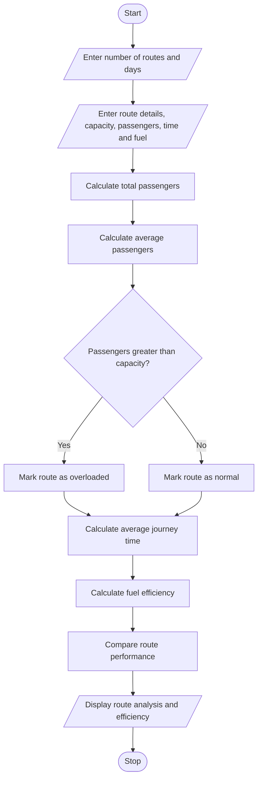

## 1. Problem Statement

Develop a Python program to analyse bus route performance over multiple days. The program should process passenger demand, journey times, fuel consumption, and bus capacities. It should identify overloaded routes, calculate average journey time and fuel efficiency, and compare operating efficiency across different routes using supplied criteria.

## 2. Algorithm

1. Start the program.
2. Enter the number of bus routes.
3. Enter route name, bus capacity, passenger count, journey time, and fuel usage for each route.
4. Calculate average passenger demand.
5. Compare passenger count with bus capacity.
6. Identify overloaded routes.
7. Calculate average journey time.
8. Calculate fuel efficiency using passengers per litre.
9. Compare route performance.
10. Display overloaded routes and operating efficiency.
11. Stop the program.

## 3. Flowchart (Mermaid)





 

## 5. Sample Input

```
Enter number of bus routes: 2
Enter number of days: 2

Route 1
Enter route name: Vijayawada
Enter bus capacity: 50
Day 1
Enter passengers: 60
Enter journey time: 2
Enter fuel used: 10
Day 2
Enter passengers: 55
Enter journey time: 2.5
Enter fuel used: 12

Route 2
Enter route name: Guntur
Enter bus capacity: 60
Day 1
Enter passengers: 40
Enter journey time: 1.5
Enter fuel used: 8
Day 2
Enter passengers: 50
Enter journey time: 2
Enter fuel used: 10
```

## 6. Sample Output

```
--- BUS ROUTE PERFORMANCE REPORT ---

Route: Vijayawada
Average Passengers: 57.5
Average Journey Time: 2.25
Fuel Efficiency: 5.22
Status: Overloaded

Route: Guntur
Average Passengers: 45.0
Average Journey Time: 1.75
Fuel Efficiency: 5.0
Status: Normal

--- OPERATING EFFICIENCY RANKING ---

Vijayawada Efficiency: 5.22
Guntur Efficiency: 5.0

--- OVERLOADED ROUTES ---

Vijayawada
```

